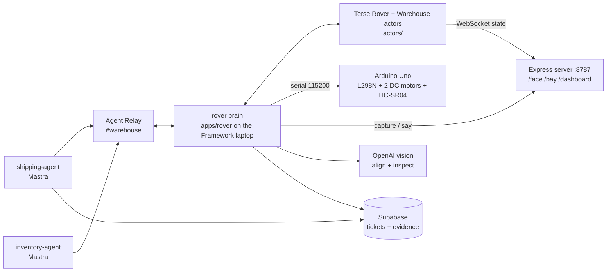

# 👻 Ghost Shipments: Rover Relay

It's 3 a.m. in a warehouse. The system says shipment **SHP-1042** is staged in **Bay B** for the 6 a.m. truck, but no scanner ever confirmed it. A `shipping-agent` pages a physical rover over **Agent Relay**: "check bay B: is SHP-1042 there, what does the label say, any damage?" The rover drives to Bay B, reads the shipping label with OpenAI vision, says what it found out loud, and replies in the Relay thread with a photo. `shipping-agent` then files an exception ticket in **Supabase**. A *ghost shipment* is one that is in the system but not on the shelf.

Built at YC Haunted Hacks (hosts Terse and Agent Relay; organizers Freestyle and Superserve; sponsors OpenAI and Supabase), Oct 31 2026.

**Demo video:** https://www.youtube.com/watch?v=s6QnHTjyqMQ

## Why this needs Terse and Agent Relay

- **One robot, many agents: who is in control?** The Terse `Rover` actor handles one request at a time. It holds a possession lease for the agent whose mission is running, queues other pages by priority (P1 truck-leaving beats P2 cycle-count), and **REJECTS** direct drive commands from anyone else: `rover is possessed by shipping-agent`.
- **Crashes.** Each mission step is persisted in the actor with `advance()` *before* the rover acts on it. Kill the rover process mid-mission: the Arduino watchdog stops the wheels within 500 ms, `scripts/run-rover.sh` restarts the brain, it calls `Rover.recover()` and says "Resuming mission, step N of 5".
- **Any agent reaches the body by messaging `@rover`.** Agents talk in the Relay channel `#warehouse`; the rover answers in the page's thread. Every Relay message is mirrored into the actor log (`Rover.logEvent`), so the dashboard shows the whole conversation live.

## Architecture



Three tiers, from DECISIONS.md:

| Tier | Where | Job |
|---|---|---|
| Reflexes | `firmware/rover/rover.ino` on the Uno | Stops for obstacles under 20 cm, stops the wheels if the host goes silent for 500 ms, caps every move at 3 s. Can refuse any move, whatever the AI says. |
| Brain stem | Terse `Rover` actor (`actors/src/actors.ts`) | Source of truth: mission queue, possession lease, e-stop, pose, heartbeat, log. Decides every move. |
| Mind | Agents over Agent Relay (`apps/agents/`) + rover brain (`apps/rover/`) | Parse pages, plan the 5-step mission, drive, look, speak, report, file tickets. |

## How each sponsor's tech is used

| Tech | How |
|---|---|
| **Terse Durable Actors** | `Rover` (id `rover-1`) and `Warehouse` (id `wh-1`) in `actors/src/actors.ts`. `@Persisted @Emittable` mission queue, `possessedBy` lease (120 s, renewed on `advance`), `estop`/`resume`, `recover()` after a crash, heartbeat alarm that flips mode to `offline` after 5 s of silence. State is pushed over WebSocket (`prepareWebsocket`) to the dashboard. Generated client in `actors/generated/`. |
| **Agent Relay** | `@agent-relay/sdk`, wrapped once in `packages/shared/src/relay.ts`. Handles `rover`, `shipping-agent`, `inventory-agent` in channel `#warehouse`. Pages and replies are threads; the rover's `REPORT {json}` reply line is what triggers the ticket. |
| **Mastra** | `@mastra/core` agents in `apps/agents/`: a page parser with structured output (`parse.ts`, regex fallback) and the ticket summary in `shipping-agent.ts`. |
| **OpenAI** | Vision in `apps/rover/src/vision.ts`: ALIGN (nudge toward the label) and INSPECT (shipment id, damage, verdict) with strict JSON schema responses. Mastra agents use `openai/gpt-5.5`. Voice is the browser's speech synthesis on the `/face` page. |
| **Supabase** | `supabase/migrations/001_init.sql`: `tickets` and `mission_events` tables, public `evidence` bucket. The rover uploads the photo (`evidence.ts`) and gets a public URL; `shipping-agent` inserts the ticket. |
| **Freestyle** | Planned hosting of the dashboard and server at a `*.style.dev` URL (see `apps/server/README.md`). Not deployed in the demo. |
| **Superserve** | Dropped for time. |

## Hardware

- **Framework laptop** on the rover: webcam = eyes, display = ghost face (`/face`), speaker = voice. Runs the rover brain, the server and the actors.
- **Arduino Uno + L298N + 2 DC motors + HC-SR04 ultrasonic.** Wiring, pins and calibration constants: [firmware/README.md](firmware/README.md).

Serial protocol (115200 baud, newline-terminated, boot prints `READY`):

| Cmd | Meaning | Reply |
|---|---|---|
| `F <ms> <speed>` | forward; obstacle under 20 cm stops it | `DONE` or `BLOCKED <cm>` |
| `B <ms> <speed>` | back | `DONE` |
| `L <deg>` / `R <deg>` | turn in place | `DONE` |
| `M <left> <right> <ms>` | raw tank drive, -255..255 | `DONE` |
| `S` | stop now | `OK` |
| `D` | distance in cm (`999` = clear) | `D <cm>` |
| `P` | ping / keepalive, sent every 200 ms during moves | `OK` |

Watchdog: while moving, no line for 500 ms stops the motors (`WATCHDOG`). Moves capped at 3000 ms, speed at 200.

Floor map. No physical boxes; bays are floor coordinates, every path goes through HOME. The "package" is a phone showing `/bay?bay=2` held at camera height ~40 cm past the bay point.

```
            1  Bay A  (0, +80)
            |
 Bay D 4 -- 5 -- 2  Bay B      5 = HOME (0, 0), rover starts here facing Bay A
(-80, 0)    |      (+80, 0)
            3  Bay C  (0, -80)
```

## Run it

**Honest status:** the demo day run used the simulated serial link (`ROVER_FAKE=1`). The firmware is in the repo and was not verified on the Uno as of submission.

Prerequisites: Node 20, Bun >= 1.4, Terse CLI (`bunx terse-cli@latest install --yes`).

```sh
npm install
cp .env.example .env      # fill in OPENAI_API_KEY, SUPABASE_URL, SUPABASE_SERVICE_KEY, RELAY_WORKSPACE_KEY
                          # (leave RELAY_WORKSPACE_KEY empty once: the first agents run creates a workspace and prints it)
# run supabase/migrations/001_init.sql in the Supabase SQL editor
cd actors && bun install && cd ..
```

Three terminals from the repo root:

```sh
(cd actors && terse actor dev)           # 1: Terse actors on :7100
npm run server                           # 2: Express on :8787
ROVER_FAKE=1 bash scripts/run-rover.sh   # 3: rover brain, sim wheels (drop ROVER_FAKE=1 with the Arduino plugged in)
```

Pages: `http://localhost:8787/face` (click **Enable camera & audio**, keep visible), `/dashboard` on the big screen (press **Reset demo**), `http://<laptop-ip>:8787/bay?bay=2` on a phone (the label; **Remove package** makes it a ghost).

| Beat | Command |
|---|---|
| Page the rover | `npm start -w apps/agents -- page B SHP-1042` |
| Conflict (P1 + P2, then REJECTED) | `npm run conflict` |
| Crash | `pkill -f apps/rover/src/index.ts` mid-mission; it restarts in 2 s and resumes |
| Obstacle (sim) | `touch apps/rover/.block`, then **Re-home** on the dashboard |
| E-stop | dashboard button or Esc, then **Resume** |

Full run sheet: [DEMO.md](DEMO.md). Sim details: [BACKUP-SIM.md](BACKUP-SIM.md).

## Repo layout

```
actors/                    Terse Rover + Warehouse actors, generated client
apps/rover/                rover brain: serial link, 5-point drive, mission executor, vision, Relay "rover" agent
apps/server/               Express on :8787, pages /face /bay /dashboard, capture/say relay
apps/agents/               Mastra shipping-agent + inventory-agent, conflict script
packages/shared/           shared types and the Agent Relay adapter
firmware/rover/            Arduino sketch (rover.ino)
supabase/migrations/       tickets, mission_events, evidence bucket
scripts/run-rover.sh       restart loop for the crash beat
```

Docs: [DECISIONS.md](DECISIONS.md) (source of truth), [DEMO.md](DEMO.md), [BACKUP-SIM.md](BACKUP-SIM.md), [hardware-tests.md](hardware-tests.md), [flow.md](flow.md). `initial-plan.md`, `use-case.md`, `flow.md` and `hardware-tests.md` are historical planning docs.

## Team

Abhijit Betigeri, Day Nguyen, Cody Wang, <name>. Built in about 5 hours at YC Haunted Hacks, Oct 31 2026. AI coding assistants were used.
